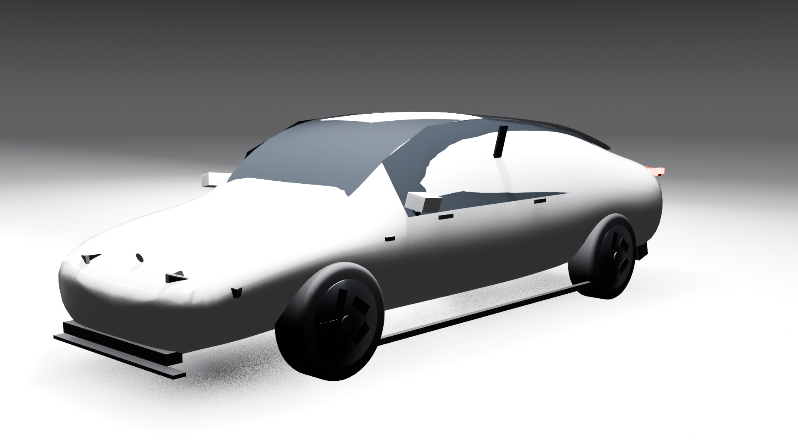
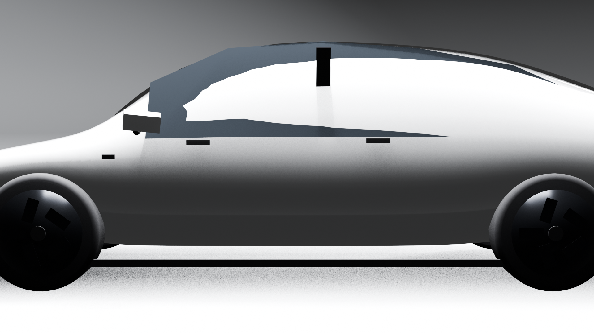
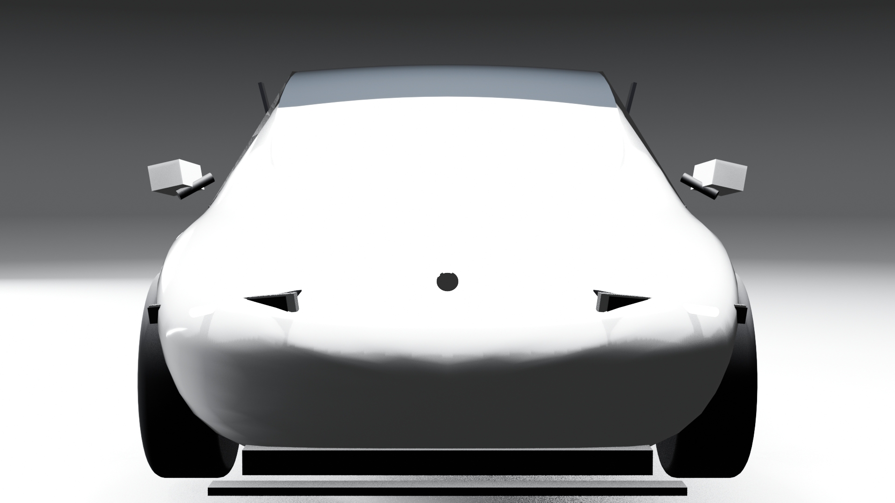
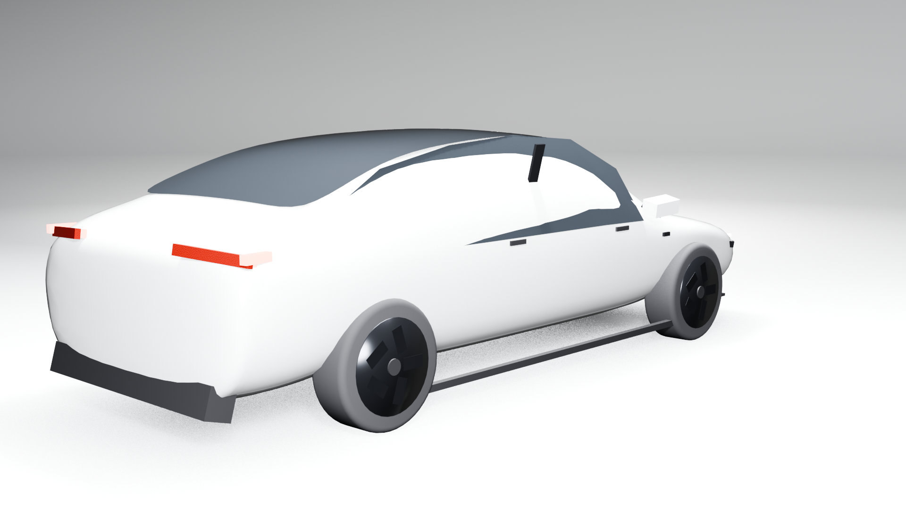
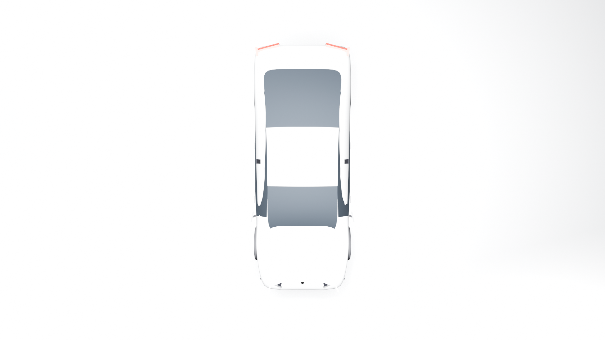
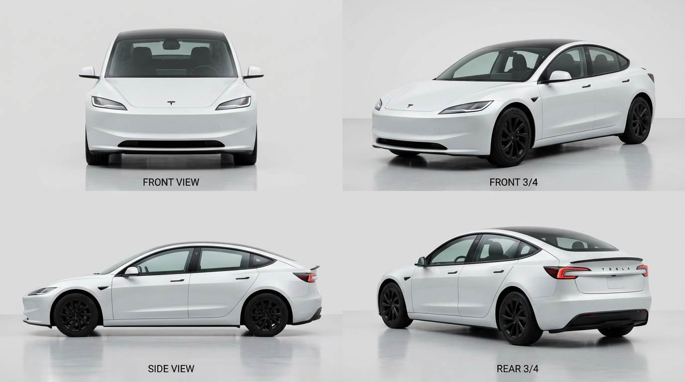

# Blender & AI Playground

Automating Blender 3D scene construction, procedural modeling, and studio rendering with AI agents and MCP (Model Context Protocol).

## Studies

### 1. Tesla Model 3 (Highland) 3D Study
- **Goal**: Take AI-generated multi-angle studio automotive references (Front, Front 3/4, Side 90°, Rear 3/4) and construct a complete, proportional 3D vehicle scene in Blender using the Model Context Protocol.
- **Scene Script**: [`tesla_scene.py`](tesla_scene.py)
- **Render Script**: [`render_all_views.py`](render_all_views.py)
- **Packaged Study**: [`artifacts/002-tesla-model-3/`](artifacts/002-tesla-model-3/)
- **Features**:
  - Full-scale Model 3 Highland proportions ($4.72\text{ m}$ length, $1.85\text{ m}$ width, $1.44\text{ m}$ height, $2.875\text{ m}$ wheelbase).
  - Shark-nose front fascia, lower chin intake, and aerodynamic splitter.
  - Panoramic tinted glass canopy flowing seamlessly from windshield cowl over roof to rear decklid.
  - Highland horizontal slit LED headlights with emissive DRL light guides.
  - C-clamp wrap-around red LED taillight bars.
  - 18" Aero Wheels with directional bladed covers, center hub caps, ventilated brake discs, and calipers.
  - Flush door handles, side mirrors, autopilot cameras, and minimalist interior silhouette (touchscreen & dashboard).
  - 360° seamless cyclorama studio with multi-point softbox studio lighting.

#### Renders
| Hero 3/4 View | Direct Side Profile | Direct Front View |
| :---: | :---: | :---: |
|  |  |  |

| Rear 3/4 View | Top Down View | 4-View Reference Sheet |
| :---: | :---: | :---: |
|  |  |  |

---

### 2. Sandwich Food Styling Study
- **Packaged Study**: [`artifacts/001-sandwich/`](artifacts/001-sandwich/)
- **Scene Script**: [`sandwich_scene.py`](sandwich_scene.py)
- **Documentation**: See [`BLENDER_MCP_PLAYBOOK.md`](BLENDER_MCP_PLAYBOOK.md) for lessons learned on procedural shaders, live Blender enum checks, and render review loops.

---

## Usage

### Prerequisites
- Blender 5.2.2 LTS (or compatible) with **MCP for Blender** add-on enabled (`127.0.0.1:9876`).
- `uv` Python package manager.

### Inspect Live Scene
```sh
uv run --with mcp-for-blender python blender_mcp_client.py scene
```

### Build the Tesla Model 3 Scene in Blender
```sh
uv run --with mcp-for-blender python blender_mcp_client.py exec tesla_scene.py --prompt "Build Tesla Model 3 Highland scene"
```

### Render All Studio Cameras via Blender CLI
```sh
/Applications/Blender.app/Contents/MacOS/Blender -b tesla-model-3.blend --python render_all_views.py
```
